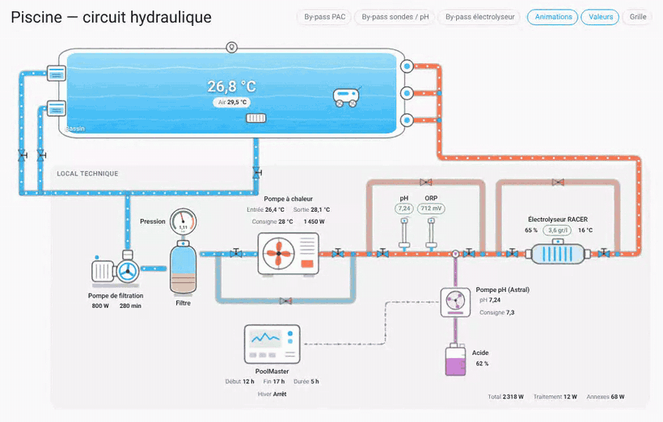
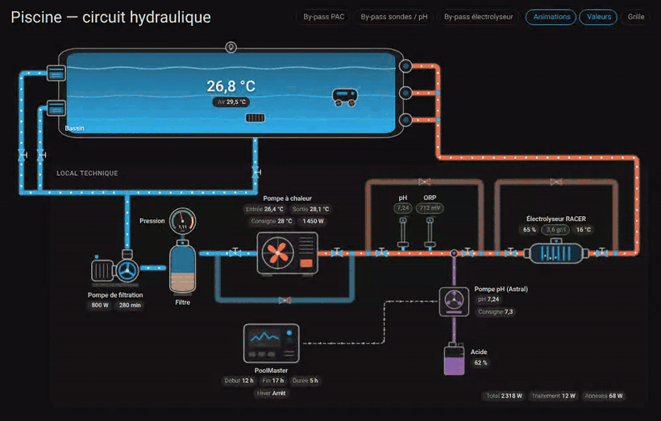
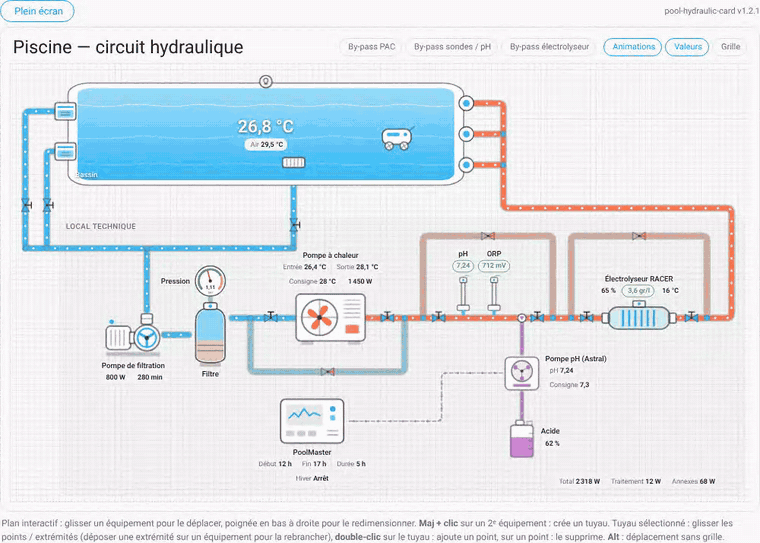

# Pool Hydraulic Card

[English](README.md) · **Français**

[](https://hacs.xyz)
[](https://github.com/freddye83/pool-hydraulic-card/releases)
[](https://github.com/freddye83/pool-hydraulic-card/actions/workflows/validate.yml)
[](LICENSE)

Une carte Lovelace pour [Home Assistant](https://www.home-assistant.io/) qui dessine le **plan hydraulique de votre piscine** et l'anime : l'eau circule dans les tuyaux quand la filtration tourne, les vannes la bloquent ou la dévient, la pompe à chaleur la colore en orange, la pompe doseuse injecte l'acide, et chaque valeur utile s'affiche au bon endroit.

Inspirée de [kjanas/ha-homelab-map](https://github.com/kjanas/ha-homelab-map) : les équipements sont placés au pixel et reliés par des tuyaux, avec en plus un **éditeur visuel complet** (glisser-déposer, tracé des tuyaux, plein écran).



---

## Sommaire

- [Fonctionnalités](#fonctionnalités)
- [Captures](#captures)
- [Installation](#installation)
- [Démarrage rapide](#démarrage-rapide)
- [Éditeur visuel](#éditeur-visuel)
- [Référence de configuration](#référence-de-configuration)
  - [Options de la carte](#options-de-la-carte)
  - [Équipements](#équipements)
  - [Badges](#badges)
  - [Tuyaux](#tuyaux)
  - [By-pass](#by-pass)
  - [Fluides](#fluides)
  - [Actions](#actions)
- [Évaluation des états](#évaluation-des-états)
- [Exemples](#exemples)
- [Dépannage](#dépannage)
- [Changelog](#changelog) · [Licence](#licence)

---

## Fonctionnalités

- **30 équipements de piscine** avec des pictogrammes animés : bassin, spa, skimmer, bonde de fond, buse de refoulement, pompe de filtration, filtre à sable, pompe à chaleur, réchauffeur / échangeur, panneau solaire, électrolyseur au sel, lampe UV, contrôleur, pompe doseuse, bidon de produit (avec niveau), sonde, manomètre (aiguille et zones colorées), débitmètre, vannes 2 voies / 3 voies / clapet anti-retour, point d'injection, raccord en T, robot, projecteur, régulateur de niveau, accessoire générique (icône ou image), badges de valeurs, texte et zones.
- **Flux d'eau animé** : piloté par n'importe quelle entité (pompe en marche, puissance au-dessus d'un seuil…), coupé par les vannes fermées, coloré en eau chaude quand la PAC chauffe, vitesse éventuellement liée à un capteur.
- **By-pass** : un clic sur une vanne bascule tout le by-pass (vannes de ligne fermées, vanne de by-pass ouverte) et l'eau prend visiblement l'autre chemin. La position est **mémorisée** et partagée sur tous vos appareils, sans créer d'entrée (helper).
- **États en direct** : pompes et ventilateurs qui tournent, électrolyseur qui bulle, vagues, eau éclairée quand le projecteur est allumé, niveau des bidons, aiguille du manomètre, alarme rouge clignotante, cadre rouge pointillé quand un appareil est hors ligne.
- **Les valeurs au bon endroit** : badges avec icône, unité, décimales et seuils de couleur (pH, ORP, salinité, pression…).
- **Éditeur visuel** : déplacement à la souris, redimensionnement, création de tuyaux par <kbd>Maj</kbd>+clic, points de passage déplaçables, rebranchement des extrémités par glisser-déposer, formulaires pour toutes les options, **mode plein écran**.
- **Aspect Home Assistant natif** : suit le thème (clair / sombre, bordure et fond de carte), compatible avec la disposition en *sections*, les conditions de visibilité, et met les animations en pause hors de l'écran ou quand la réduction des animations est demandée.

## Captures

| Thème clair | Thème sombre |
|---|---|
|  |  |

**By-pass** : un clic sur une vanne ou sur un bouton de l'en-tête dévie l'eau.



## Installation

### HACS (recommandé)

[](https://my.home-assistant.io/redirect/hacs_repository/?owner=freddye83&repository=pool-hydraulic-card&category=plugin)

Pool Hydraulic Card fait partie du catalogue HACS par défaut : inutile d'ajouter un dépôt personnalisé.

Cliquez sur le bouton ci-dessus, ou à la main :

1. Ouvrez **HACS** dans Home Assistant.
2. Recherchez **Pool Hydraulic Card**, ouvrez-la et cliquez sur **Télécharger**.
3. Rechargez le navigateur (<kbd>Ctrl</kbd>+<kbd>F5</kbd>). Dans l'application mobile, videz le cache du frontend.
4. Ajoutez la carte à un tableau de bord : **Modifier le tableau de bord → Ajouter une carte**, recherchez **Plan hydraulique piscine**.

> **Déjà installée en dépôt personnalisé ?** Rien à faire : les mises à jour continuent d'arriver par HACS. Vous pouvez supprimer l'entrée dans **HACS → ⋮ → Dépôts personnalisés** si vous le souhaitez.

HACS déclare automatiquement la ressource du tableau de bord. Si ce n'est pas le cas (tableaux de bord en mode YAML), ajoutez-la :

```yaml
url: /hacsfiles/pool-hydraulic-card/pool-hydraulic-card.js
type: module
```

Les mises à jour sont ensuite proposées par HACS comme pour les autres cartes.

### Installation manuelle

1. Téléchargez `pool-hydraulic-card.js` depuis la [dernière release](https://github.com/freddye83/pool-hydraulic-card/releases/latest).
2. Copiez-le dans `/config/www/pool-hydraulic-card/pool-hydraulic-card.js` (Samba, Studio Code Server, File editor…). Si le dossier `www` n'existait pas, redémarrez Home Assistant une fois.
3. **Paramètres → Tableaux de bord → ⋮ → Ressources → Ajouter une ressource**
   - URL : `/local/pool-hydraulic-card/pool-hydraulic-card.js?v=1.3.0`
   - Type : **Module JavaScript**

   Ou dans `configuration.yaml` (tableaux de bord en mode YAML) :
   ```yaml
   lovelace:
     resources:
       - url: /local/pool-hydraulic-card/pool-hydraulic-card.js?v=1.3.0
         type: module
   ```
4. Rechargez le navigateur (<kbd>Ctrl</kbd>+<kbd>F5</kbd>).

> Lors d'une mise à jour manuelle, remplacez le fichier et incrémentez `?v=` dans l'URL de la ressource pour forcer le rechargement.

**Prérequis :** Home Assistant 2024.11 ou plus récent. La version installée s'affiche dans la console du navigateur (`POOL-HYDRAULIC-CARD v1.3.0`) et en haut de l'éditeur visuel.

## Démarrage rapide

Ajoutez une carte depuis l'éditeur du tableau de bord : recherchez **Plan hydraulique piscine** dans le sélecteur. Un petit plan d'exemple est créé ; ouvrez l'éditeur visuel pour placer vos équipements et choisir vos entités.

Ou collez ce YAML minimal (remplacez les entités par les vôtres) :

```yaml
type: custom:pool-hydraulic-card
title: Piscine
width: 760
height: 420
items:
  - { type: pool, id: bassin, name: Bassin, at: [40, 20], size: [420, 140],
      entity: switch.pompe_piscine, temperature_entity: sensor.temperature_eau }
  - { type: skimmer, id: skimmer, at: [122, 146] }
  - { type: inlet, id: buse, at: [420, 146], entity: switch.pompe_piscine }
  - { type: zone, id: local, name: Local technique, at: [20, 200], size: [720, 200] }
  - { type: pump, id: pompe, name: Pompe de filtration, at: [70, 260], entity: switch.pompe_piscine }
  - { type: filter, id: filtre, name: Filtre à sable, at: [220, 246] }
  - { type: heat_pump, id: pac, name: Pompe à chaleur, at: [340, 255], entity: climate.pac_piscine }
pipes:
  - { start: skimmer, start_edge: bottom, end: pompe, end_edge: top, end_point: 72, flow_entity: switch.pompe_piscine }
  - { start: pompe, end: filtre, flow_entity: switch.pompe_piscine }
  - { start: filtre, start_point: 25, end: pac, flow_entity: switch.pompe_piscine }
  - { start: pac, end: buse, end_edge: bottom, points: [[600, 300], [600, 186], [435, 186]],
      flow_entity: switch.pompe_piscine, hot_entity: climate.pac_piscine }
```

Un plan réel complet (deux skimmers, bonde de fond, trois buses, PAC, sondes, régulation pH, électrolyseur et trois by-pass) est disponible dans [`examples/full-pool.yaml`](examples/full-pool.yaml).

## Éditeur visuel



L'éditeur affiche un **plan interactif** au-dessus des réglages :

| Geste | Résultat |
|---|---|
| Glisser un équipement | Le déplace (aimanté à la grille, <kbd>Alt</kbd> pour un placement libre) |
| Glisser la poignée en bas à droite de la sélection | Redimensionne l'équipement |
| Sélectionner un équipement puis <kbd>Maj</kbd>+clic sur un autre | Crée un tuyau entre les deux, côtés choisis automatiquement |
| Sélectionner un tuyau, glisser un point | Déplace un point de passage (un tracé automatique devient modifiable au premier glisser) |
| Déposer une extrémité orange sur un autre équipement | Rebranche le tuyau (côté et position calculés) |
| Double-clic sur un tuyau / un point | Ajoute / supprime un point de passage |
| Bouton **Plein écran** | Le plan occupe l'écran, les réglages passent en colonne ; <kbd>Échap</kbd> pour quitter |

Sous le plan, trois onglets :

- **Général** : taille du plan, tuyaux, barre d'outils, mémorisation, couleurs des fluides et **by-pass**.
- **Équipements** : liste (l'ordre = l'empilement), ajout / duplication / suppression, toutes les options de l'équipement sélectionné et ses badges. Renommer un `id` met à jour les tuyaux et les by-pass qui l'utilisent.
- **Tuyaux** : liste, ajout / duplication / suppression / inversion, toutes les options du tuyau sélectionné.

Les onglets standard **Visibilité** et **Disposition** de Home Assistant restent disponibles.

> La carte et son éditeur suivent la langue de Home Assistant : français, ou anglais pour toutes les autres langues. Les options YAML sont toujours en anglais.

## Référence de configuration

Positions et tailles sont en **pixels du plan** (`width` × `height`). Le plan est ensuite mis à l'échelle de la largeur de la carte. Les noms d'options sont en anglais.

### Options de la carte

| Option | Défaut | Description |
|---|---|---|
| `title` | — | Titre de la carte. |
| `width` / `height` | `1000` / `600` | Taille du plan en pixels. |
| `scale` | auto | Zoom fixe. Par défaut le plan s'ajuste à la largeur de la carte. |
| `max_scale` | — | Zoom automatique maximal. |
| `pipe_width` | `8` | Épaisseur par défaut des tuyaux. |
| `line_radius` | `8` | Rayon des coudes. |
| `flow_speed` | `40` | Vitesse des points de flux, en px/s. |
| `grid_size` | `5` | Pas de la grille dans l'éditeur. |
| `font` | thème | Police. |
| `show_toggles` | `true` | Affiche les boutons *Animations / Valeurs / Grille* (choix mémorisés par navigateur). |
| `animations` / `show_values` / `debug` | `true` / `true` / `false` | État initial de ces boutons (`debug` = grille de coordonnées). |
| `fluids` | voir [Fluides](#fluides) | Modifier ou ajouter des couleurs de fluide. |
| `bypasses` | — | Voir [By-pass](#by-pass). |
| `bypass_storage` | `system` | Mémorisation des by-pass : `system`, `user` ou `local`. |
| `storage_key` | titre | Clé de mémorisation des by-pass. À fixer pour ne pas perdre les positions si la carte est renommée. |
| `show_bypass_buttons` | `true` | Un bouton par by-pass dans l'en-tête. |
| `items` | **obligatoire** | Liste des [équipements](#équipements). |
| `pipes` | — | Liste des [tuyaux](#tuyaux). |

### Équipements

Chaque équipement a un `type`, un `id` unique, une position `at: [x, y]` (coin haut-gauche) et une taille optionnelle `size: [largeur, hauteur]` (défauts ci-dessous). Ils sont dessinés dans l'ordre de la liste : les derniers passent au-dessus.

#### Options communes

| Option | Description |
|---|---|
| `name` | Libellé affiché à côté de l'équipement. |
| `entity` | Entité principale (marche / ouvert). Pilote les animations et la couleur d'accent. |
| `on_state` | États considérés « en marche » (liste ou texte séparé par des virgules). |
| `on_above` | États numériques : « en marche » au-dessus de cette valeur (défaut `0`). |
| `status_entity` | Disponibilité : éteinte ou indisponible → cadre rouge pointillé et équipement grisé. |
| `alarm_entity` | Alarme : l'équipement clignote en rouge quand cette entité est dans `alarm_state`. |
| `alarm_state` | État d'alarme (défaut `on`). Utilisez `"off"` pour les capteurs « OK » comme *niveau bidon OK*. |
| `label_position` | `bottom`, `top`, `left`, `right`, `inside` ou `none` (nom masqué ; badges en dessous). |
| `show_name` | `false` masque le nom. |
| `badges` | Liste de [badges](#badges) affichés avec le libellé. |
| `badges_offset` | Décalage `[dx, dy]` du bloc libellé. |
| `fluid` | Fluide utilisé pour la couleur (eau du filtre, liquide du bidon, tête de pompe doseuse). |
| `accent_color` | Couleur des parties actives (`red`, `orange`, `green`, `yellow`, `blue`, `primary` ou couleur CSS). |
| `tap_action` | Voir [Actions](#actions). Par défaut : fiche (more-info) de `entity`. |

#### Types d'équipements

| Type | Taille par défaut | Options et comportement |
|---|---|---|
| `pool` | 300×150 | `temperature_entity` (grande valeur centrée), `temperature_decimals` (1), `light_entity` (l'eau prend la couleur de l'éclairage allumé), `light_color` (`#00e5ff`, si la lampe n'a pas de couleur RVB), `cover_entity` (lames proportionnelles à la position du volet). Vagues animées quand `entity` est en marche. Libellé `inside` par défaut. |
| `spa` | 140×110 | Comme `pool` ; bulles quand `entity` est en marche. |
| `skimmer` | 40×36 | — |
| `drain` | 40×22 | Bonde de fond. |
| `inlet` | 30×30 | Buse de refoulement ; pulse quand `entity` est en marche. |
| `pump` | 100×80 | Turbine qui tourne ; `speed_entity`, `speed_min`, `speed_max` modulent la vitesse. L'aspiration (préfiltre) est en `top`, `end_point: 72`. |
| `filter` | 70×108 | Filtre à sable avec vanne multivoies ; niveau d'eau visible quand `entity` est en marche. |
| `heat_pump` | 120×90 | Ventilateur qui tourne, accent couleur eau chaude. |
| `heater` | 80×60 | Réchauffeur électrique ou échangeur. |
| `solar` | 100×60 | Panneau solaire. |
| `electrolyser` | 120×60 | Cellule d'électrolyse ; bulles quand `entity` est en marche (ex. production > 0). |
| `uv` | 120×40 | Lampe UV, lumineuse en marche. |
| `controller` | 120×80 | Contrôleur / régulateur (écran et LED). |
| `dosing_pump` | 64×64 | Pompe péristaltique, galets qui tournent pendant le dosage. Fluide `ph` par défaut. |
| `tank` | 50×66 | Bidon de produit ; `level_entity` (%) le remplit. Fluide `ph` par défaut. |
| `probe` | 28×70 | Sonde pH / ORP / température. Mettez la valeur dans `badges`. Libellé `top` par défaut. |
| `gauge` | 54×54 | Manomètre : `min` (0), `max` (3), `warn_above` (zone orange), `alarm_above` (zone rouge, clignote si dépassé), `unit`, `decimals` (2). `min`, `max` et les seuils acceptent un nombre **ou un id d'entité**. |
| `flowmeter` | 70×40 | Rotor qui tourne quand `entity` est en marche. |
| `valve` | 28×28 | Vanne 2 voies. `orientation` : `horizontal` / `vertical`. Sans `entity` : `default_state` `open` / `closed`, ou pilotée par un [by-pass](#by-pass). |
| `valve3` | 40×40 | Vanne 3 voies : voie commune à gauche, voie **A** à droite, voie **B** en bas. `entity` en marche = B. `rotation` : 0/90/180/270. `default_state` : `a` / `b`. |
| `check_valve` | 30×30 | Clapet anti-retour, `rotation` donne le sens. |
| `injection` | 18×18 | Point d'injection de produit. |
| `junction` | 12×12 | Raccord / T. Branchez les tuyaux en `center` ou sur un côté. |
| `robot` | 56×44 | Robot de nettoyage, roues qui tournent en marche. |
| `light` | 30×30 | Projecteur : lentille et rayons allumés en marche (couleur RVB si disponible). |
| `float` | 30×60 | Régulateur de niveau : flotteur en haut quand `entity` est en marche. |
| `device` | 70×60 | Accessoire générique : `icon` (n'importe quelle icône `mdi:`) ou `image` (URL). |
| `badge` | 120×24 | Valeurs seules (sans pictogramme). `direction` : `row` / `column`. |
| `label` | 120×24 | Texte libre : `name`, `font_size` (14), `align` (`left`/`center`/`right`), `bold`, `color`. |
| `zone` | 400×200 | Cadre pointillé avec titre (local technique…). Il ne capte pas les clics (sélection par son titre dans l'éditeur). Placez-le en premier pour qu'il reste derrière. |

### Badges

Les badges affichent des valeurs à côté d'un équipement (ou seuls avec le type `badge`).

```yaml
badges:
  - entity: sensor.ph_piscine
    name: pH
    icon: mdi:ph
    decimals: 2
    thresholds:
      - { below: 7.0, color: orange }
      - { above: 7.0, color: green }
      - { above: 7.6, color: orange }
      - { above: 8.0, color: red }
```

| Option | Description |
|---|---|
| `entity` | **Obligatoire.** Un clic ouvre la fiche de l'entité. |
| `name` | Texte devant la valeur. |
| `icon` | Icône `mdi:`. |
| `attribute` | Affiche un attribut au lieu de l'état. |
| `unit` | Remplace l'unité. |
| `decimals` | Nombre de décimales (valeurs numériques). |
| `color` | Couleur fixe. |
| `thresholds` | Liste de `{above: N, color: …}` / `{below: N, color: …}`. Évalués dans l'ordre, **le dernier seuil atteint l'emporte**. |

Sans `decimals` ni `unit`, la valeur est formatée par Home Assistant (états traduits, unités, format régional).

### Tuyaux

Un tuyau relie deux équipements. Ses extrémités s'accrochent sur un côté de chacun.

```yaml
pipes:
  - start: filtre
    start_edge: right        # top | right | bottom | left | center
    start_point: 25          # % le long du côté (0 = haut ou gauche), défaut 50
    end: pac
    end_edge: left
    points: [[400, 213]]     # points de passage optionnels, en pixels du plan
    fluid: eau
    flow_entity: switch.pompe_piscine
    valves: [v_pac_entree, v_pac_sortie]
    hot_entity: climate.pac_piscine
```

| Option | Défaut | Description |
|---|---|---|
| `start` / `end` | — | Ids des équipements. Une extrémité peut être omise si `points` est renseigné : le premier / dernier point devient une extrémité libre. |
| `start_edge` / `end_edge` | `right` / `left` | Côté de l'équipement : `top`, `right`, `bottom`, `left` ou `center`. |
| `start_point` / `end_point` | `50` | Position le long du côté, en %. Sur `top`/`bottom`, 0 = coin gauche ; sur `left`/`right`, 0 = coin haut. |
| `points` | auto | Points de passage. Sans eux, un tracé orthogonal est calculé. |
| `fluid` | `eau` | Nom du fluide (couleur), voir [Fluides](#fluides). |
| `flow_entity` | — | Entité, ou liste d'entités, qui doivent **toutes** être en marche pour que l'eau circule. |
| `flow_on_above` / `flow_state` | — | Même rôle que `on_above` / `on_state` pour les entités de flux. |
| `always_flow` | `false` | Flux permanent, sans entité. |
| `valves` | — | Vannes traversées. Le flux s'arrête si l'une est fermée. Pour une vanne 3 voies, écrivez `id:a` ou `id:b` (flux seulement sur cette voie). |
| `hot_entity` | — | Quand elle est en marche, le tuyau prend la couleur `hot_fluid` (défaut `chaude`). |
| `reverse` | `false` | Animation de `end` vers `start`. |
| `style` | `dots` | Animation : `dots` (points), `dashes` (tirets) ou `none`. |
| `width` | `pipe_width` | Épaisseur (2 par défaut pour les fluides fins). |
| `speed` | `flow_speed` | Vitesse de l'animation en px/s. |
| `speed_entity`, `speed_min`, `speed_max` | — | Vitesse proportionnelle à un capteur (ex. vitesse de pompe en %). |
| `color` | — | Couleur fixe, remplace celle du fluide. |
| `tap_action` | more-info | Clic sur le tuyau ; par défaut la première entité de flux. |

### By-pass

Un by-pass regroupe des vannes qui bougent ensemble. Quand il est **activé**, ses vannes `line` se ferment et ses vannes `bypass` s'ouvrent ; désactivé, c'est l'inverse. Les tuyaux qui déclarent ces vannes dans `valves` s'arrêtent ou reprennent : l'eau prend visiblement l'autre chemin.

```yaml
bypass_storage: system
storage_key: piscine
bypasses:
  - id: bp_electrolyse
    name: By-pass électrolyseur
    line: [v_elec_entree, v_elec_sortie]   # fermées quand le by-pass est activé
    bypass: [v_elec_bypass]                # ouvertes quand il est activé
    default: false                         # position initiale
    # entity: input_boolean.bypass_electrolyseur   # optionnel, voir plus bas
```

Un clic sur n'importe quelle vanne du groupe, ou sur son bouton dans l'en-tête, le bascule.

**Où la position est-elle mémorisée ?**

| `bypass_storage` | Comportement |
|---|---|
| `system` (défaut) | Dans le stockage partagé du frontend Home Assistant. Même position sur tous les appareils et pour tous les utilisateurs, mise à jour en direct partout. La modification nécessite un compte **administrateur** ; les autres utilisateurs la voient seulement. |
| `user` | Par utilisateur Home Assistant, synchronisée sur ses appareils. |
| `local` | Dans le navigateur courant uniquement. |

Aucune entrée (helper) ni modification de configuration n'est nécessaire. Pour utiliser la position dans des automatisations, renseignez `entity` sur le by-pass (par exemple un `input_boolean`) : la carte lit et bascule alors cette entité.

Une vanne qui a sa propre `entity` ou un `tap_action` n'est pas pilotée par son groupe.

### Fluides

| Nom | Signification | Couleur par défaut |
|---|---|---|
| `eau` | Eau | `#29b6f6` |
| `chaude` | Eau chaude | `#ff7043` |
| `traitee` | Eau traitée | `#26c6da` |
| `ph` | pH / acide | `#ba68c8` |
| `chlore` | Chlore | `#9ccc65` |
| `air` | Air | `#b0bec5` |
| `vidange` | Vidange / égout | `#8d6e63` |
| `signal` | Liaison de commande (trait fin pointillé) | `#9e9e9e` |
| `electrique` | Liaison électrique (trait fin pointillé) | `#fbc02d` |

Modifier ou ajouter (toute couleur CSS : `#hex`, un nom de couleur, `rgb()`/`hsl()` ou `var(--…)` ; une valeur invalide reprend la couleur par défaut) :

```yaml
fluids:
  eau: "#1e88e5"
  brome: "#ffb74d"
```

### Actions

`tap_action` suit la syntaxe Home Assistant :

| `action` | Options |
|---|---|
| `more-info` (défaut) | `entity` (optionnel, par défaut l'entité de l'équipement) |
| `toggle` | `entity` (optionnel) |
| `navigate` | `navigation_path` |
| `url` | `url_path` |
| `perform-action` | `perform_action`, `data`, `target` |
| `none` | — |

## Évaluation des états

Une entité est considérée **en marche** quand :

1. son état figure dans `on_state`, si l'option est renseignée ;
2. sinon, pour un état numérique, la valeur dépasse `on_above` (défaut `0`) ;
3. sinon, l'état n'est pas l'un de `off`, `closed`, `closing`, `false`, `idle`, `standby`, `stop`, `stopped`, `paused`, `not_home`, `offline`, `disconnected`, `none`, `low`, `0`.

`unavailable` et `unknown` ne sont ni marche ni arrêt : l'équipement est estompé et ses badges affichent `?` ou *indispo.*

## Exemples

- [`examples/minimal.yaml`](examples/minimal.yaml) : bassin, skimmer, pompe, filtre et PAC.
- [`examples/full-pool.yaml`](examples/full-pool.yaml) : une installation réelle (contrôleur PoolMaster, électrolyseur RACER, pompe pH Astral, PAC, manomètre, deux skimmers, bonde de fond, trois buses et trois by-pass). Remplacez les ids d'entités par les vôtres.

## Dépannage

- **« Custom element doesn't exist: pool-hydraulic-card »** : la ressource manque ou le cache est ancien. Vérifiez l'URL de la ressource puis rechargez avec <kbd>Ctrl</kbd>+<kbd>F5</kbd> (ou videz le cache de l'application).
- **Une erreur cite `items[3]` ou `pipes[5]`** : les indices commencent à 0 ; le message nomme l'option fautive.
- **Un tuyau ne s'anime jamais** : vérifiez l'état de son `flow_entity` dans *Outils de développement → États*, et qu'aucune de ses `valves` n'est fermée.
- **Position des by-pass non enregistrée pour certains utilisateurs** : avec `bypass_storage: system`, seuls les administrateurs peuvent la changer. Utilisez `user` ou une `entity`.
- **Éditeur en plein écran sur iPhone** : Safari ne gère pas le plein écran d'un élément ; l'éditeur passe en superposition. Certaines listes (choix d'entité) peuvent ne pas s'ouvrir en plein écran ; quittez-le pour choisir l'entité.

## Changelog

Voir [CHANGELOG.md](CHANGELOG.md).

## Licence

[MIT](LICENSE) © Eric (freddye83).
Merci à [kjanas/ha-homelab-map](https://github.com/kjanas/ha-homelab-map) pour l'idée d'un plan animé positionné au pixel.
