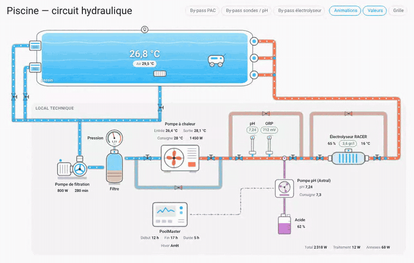
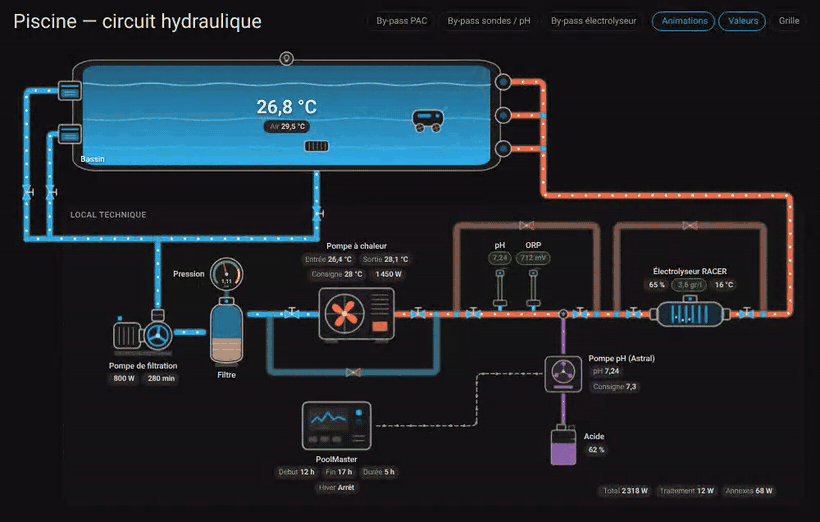
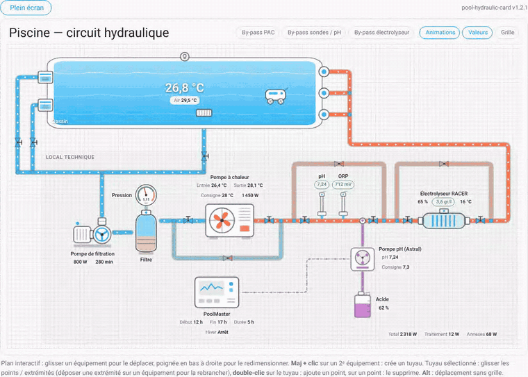

# Pool Hydraulic Card

**English** · [Français](README.fr.md)

[](https://hacs.xyz/docs/faq/custom_repositories)
[](https://github.com/freddye83/pool-hydraulic-card/releases)
[](https://github.com/freddye83/pool-hydraulic-card/actions/workflows/validate.yml)
[](LICENSE)

A Lovelace card for [Home Assistant](https://www.home-assistant.io/) that draws the **hydraulic plan of your swimming pool** and brings it to life: water flows through the pipes when the filtration runs, valves block or divert it, the heat pump turns the water orange, the dosing pump injects acid, and every value you care about is shown where it belongs.

Inspired by [kjanas/ha-homelab-map](https://github.com/kjanas/ha-homelab-map): items are placed with pixel coordinates and connected by pipes, but this card adds a **full visual editor** (drag & drop, pipe drawing, full-screen mode).



---

## Contents

- [Features](#features)
- [Screenshots](#screenshots)
- [Installation](#installation)
- [Quick start](#quick-start)
- [Visual editor](#visual-editor)
- [Configuration reference](#configuration-reference)
  - [Card options](#card-options)
  - [Items](#items)
  - [Badges](#badges)
  - [Pipes](#pipes)
  - [Bypasses](#bypasses)
  - [Fluids](#fluids)
  - [Actions](#actions)
- [How states are evaluated](#how-states-are-evaluated)
- [Examples](#examples)
- [Troubleshooting](#troubleshooting)
- [Changelog](#changelog) · [License](#license)

---

## Features

- **30 pool items** with dedicated animated pictograms: pool, spa, skimmer, main drain, return inlet, filtration pump, sand filter, heat pump, heater / heat exchanger, solar panel, salt chlorinator (electrolyser), UV lamp, controller, dosing pump, chemical tank (with level), probe, pressure gauge (needle + coloured zones), flow meter, 2-way / 3-way / check valves, injection point, junction (tee), cleaning robot, spotlight, level float, generic device (any icon or image), value badges, text and zones.
- **Animated water flow**: driven by any entity (pump running, power above a threshold…), stopped by closed valves, coloured as hot water while the heat pump runs, with speed optionally following a sensor.
- **Bypasses**: one click on a valve swaps a whole bypass (line valves close, bypass valve opens) and the water visibly takes the other path. The position is **remembered** and shared across all your devices, with no helper to create.
- **Live states**: rotating pumps and fans, bubbling chlorinator, waving water, lit pool when the spotlight is on, tank levels, gauge needle, red blinking alarms, red dashed frame when a device is offline.
- **Values where they belong**: badges with icons, units, decimals and colour thresholds (pH, ORP, salinity, pressure…).
- **Visual editor**: drag items, resize them, draw pipes with <kbd>Shift</kbd>+click, move waypoints, reconnect pipe ends by drag & drop, edit every option in forms, **full-screen mode**.
- **Native Home Assistant look**: follows your theme (light / dark, card borders and background), supports the *sections* layout, visibility conditions, and pauses animations when off-screen or when *reduce motion* is requested.

## Screenshots

| Light theme | Dark theme |
|---|---|
|  |  |

**Bypasses** — one click on a valve or a header button diverts the water:



## Installation

### HACS (recommended)

[](https://my.home-assistant.io/redirect/hacs_repository/?owner=freddye83&repository=pool-hydraulic-card&category=plugin)

Click the button above, or do it by hand:

1. Open **HACS** in Home Assistant.
2. Menu **⋮** (top right) → **Custom repositories**.
3. Repository: `https://github.com/freddye83/pool-hydraulic-card`, type: **Dashboard**, then **Add**.
4. Search for **Pool Hydraulic Card**, open it and click **Download**.
5. Reload your browser (<kbd>Ctrl</kbd>+<kbd>F5</kbd>). On the companion app, clear the frontend cache.

HACS registers the dashboard resource automatically. If it does not (YAML-mode dashboards), add it yourself:

```yaml
url: /hacsfiles/pool-hydraulic-card/pool-hydraulic-card.js
type: module
```

Updates are then offered by HACS like any other card.

### Manual installation

1. Download `pool-hydraulic-card.js` from the [latest release](https://github.com/freddye83/pool-hydraulic-card/releases/latest).
2. Copy it to `/config/www/pool-hydraulic-card/pool-hydraulic-card.js` (Samba, Studio Code Server, File editor…). If the `www` folder did not exist, restart Home Assistant once.
3. **Settings → Dashboards → ⋮ → Resources → Add resource**
   - URL: `/local/pool-hydraulic-card/pool-hydraulic-card.js?v=1.2.2`
   - Type: **JavaScript module**

   Or in `configuration.yaml` (YAML-mode dashboards):
   ```yaml
   lovelace:
     resources:
       - url: /local/pool-hydraulic-card/pool-hydraulic-card.js?v=1.2.2
         type: module
   ```
4. Reload your browser (<kbd>Ctrl</kbd>+<kbd>F5</kbd>).

> When updating manually, replace the file and bump `?v=` in the resource URL so browsers fetch the new version.

**Requirements:** Home Assistant 2024.11 or newer. The installed version is printed in the browser console (`POOL-HYDRAULIC-CARD v1.2.2`) and at the top of the visual editor.

## Quick start

Add a card from the dashboard editor: search for **Pool Hydraulic Card** in the card picker. A small sample plan is created; open the visual editor to place your equipment and pick your entities.

Or paste this minimal YAML (replace the entities with yours):

```yaml
type: custom:pool-hydraulic-card
title: Pool
width: 760
height: 420
items:
  - { type: pool, id: pool, name: Pool, at: [40, 20], size: [420, 140],
      entity: switch.pool_pump, temperature_entity: sensor.pool_water_temperature }
  - { type: skimmer, id: skimmer, at: [122, 146] }
  - { type: inlet, id: inlet, at: [420, 146], entity: switch.pool_pump }
  - { type: zone, id: plant_room, name: Plant room, at: [20, 200], size: [720, 200] }
  - { type: pump, id: pump, name: Filtration pump, at: [70, 260], entity: switch.pool_pump }
  - { type: filter, id: filter, name: Sand filter, at: [220, 246] }
  - { type: heat_pump, id: heat_pump, name: Heat pump, at: [340, 255], entity: climate.pool_heat_pump }
pipes:
  - { start: skimmer, start_edge: bottom, end: pump, end_edge: top, end_point: 72, flow_entity: switch.pool_pump }
  - { start: pump, end: filter, flow_entity: switch.pool_pump }
  - { start: filter, start_point: 25, end: heat_pump, flow_entity: switch.pool_pump }
  - { start: heat_pump, end: inlet, end_edge: bottom, points: [[600, 300], [600, 186], [435, 186]],
      flow_entity: switch.pool_pump, hot_entity: climate.pool_heat_pump }
```

A complete real-life plan (two skimmers, main drain, three return inlets, heat pump, probes, pH dosing, salt chlorinator and three bypasses) is available in [`examples/full-pool.yaml`](examples/full-pool.yaml).

## Visual editor



The editor shows an **interactive plan** above the settings:

| Action | Result |
|---|---|
| Drag an item | Moves it (snaps to the grid, hold <kbd>Alt</kbd> for free placement) |
| Drag the handle at the bottom-right of the selection | Resizes the item |
| Select an item, then <kbd>Shift</kbd>+click another one | Creates a pipe between them, sides chosen automatically |
| Select a pipe, drag a dot | Moves a waypoint (automatic routes become editable on first drag) |
| Drag an orange end of a pipe onto another item | Reconnects the pipe (side and position are computed) |
| Double-click a pipe / a waypoint | Adds / removes a waypoint |
| **Full screen** button | Plan fills the screen, settings move to a side column; <kbd>Esc</kbd> to exit |

Below the plan, three tabs:

- **General**: plan size, pipes, toolbar, storage, fluid colours and **bypasses**.
- **Items**: list (order = stacking), add / duplicate / delete, all options of the selected item and its value badges. Renaming an `id` updates every pipe and bypass that uses it.
- **Pipes**: list, add / duplicate / delete / reverse, all options of the selected pipe.

The standard **Visibility** and **Layout** tabs of Home Assistant remain available.

> The editor labels are currently in French. All YAML options are in English.

## Configuration reference

All positions and sizes are in **pixels of the plan** (`width` × `height`). The plan is then scaled to the card width.

### Card options

| Option | Default | Description |
|---|---|---|
| `title` | — | Card title. |
| `width` / `height` | `1000` / `600` | Size of the plan in pixels. |
| `scale` | auto | Fixed zoom factor. By default the plan fits the card width. |
| `max_scale` | — | Upper bound of the automatic zoom. |
| `pipe_width` | `8` | Default pipe thickness. |
| `line_radius` | `8` | Radius of pipe bends. |
| `flow_speed` | `40` | Speed of the flow dots, in px/s. |
| `grid_size` | `5` | Snap step in the visual editor. |
| `font` | theme | Font family. |
| `show_toggles` | `true` | Shows the *Animations / Values / Grid* buttons (choices are remembered per browser). |
| `animations` / `show_values` / `debug` | `true` / `true` / `false` | Initial state of these buttons (`debug` = coordinate grid). |
| `fluids` | see [Fluids](#fluids) | Override or add fluid colours. |
| `bypasses` | — | See [Bypasses](#bypasses). |
| `bypass_storage` | `system` | Where bypass positions are stored: `system`, `user` or `local`. |
| `storage_key` | title | Storage key for bypass positions. Set it so that renaming the card does not lose them. |
| `show_bypass_buttons` | `true` | One button per bypass in the card header. |
| `items` | **required** | List of [items](#items). |
| `pipes` | — | List of [pipes](#pipes). |

### Items

Each item has a `type`, a unique `id`, a position `at: [x, y]` (top-left corner) and an optional `size: [width, height]` (defaults below). Items are drawn in list order: later items are drawn on top.

#### Common options

| Option | Description |
|---|---|
| `name` | Label displayed next to the item. |
| `entity` | Main entity: running / open state. Drives animations and accent colour. |
| `on_state` | States considered "on" (list or comma-separated string). |
| `on_above` | For numeric states: "on" when the value is above this number (default `0`). |
| `status_entity` | Availability: when it is off or unavailable, the item gets a red dashed frame and turns grey. |
| `alarm_entity` | Alarm: the item blinks red when this entity is in `alarm_state`. |
| `alarm_state` | State that means alarm (default `on`). Use `"off"` for "OK" sensors such as *tank level OK*. |
| `label_position` | `bottom`, `top`, `left`, `right`, `inside` or `none` (name hidden; badges below). |
| `show_name` | `false` hides the name. |
| `badges` | List of [badges](#badges) shown with the label. |
| `badges_offset` | `[dx, dy]` shift of the label block. |
| `fluid` | Fluid used for the item colour (water fill, tank liquid, dosing head). |
| `accent_color` | Colour of the active parts (`red`, `orange`, `green`, `yellow`, `blue`, `primary` or any CSS colour). |
| `tap_action` | See [Actions](#actions). Default: more-info of `entity`. |

#### Item types

| Type | Default size | Specific options and behaviour |
|---|---|---|
| `pool` | 300×150 | `temperature_entity` (big centred value), `temperature_decimals` (1), `light_entity` (water takes the light colour when on), `light_color` (`#00e5ff`, used when the light has no RGB colour), `cover_entity` (slats proportional to the cover position). Waves move while `entity` is on. Label defaults to `inside`. |
| `spa` | 140×110 | Same as `pool`; bubbles while `entity` is on. |
| `skimmer` | 40×36 | — |
| `drain` | 40×22 | Main drain. |
| `inlet` | 30×30 | Return inlet; pulses while `entity` is on. |
| `pump` | 100×80 | Spinning impeller; `speed_entity`, `speed_min`, `speed_max` change the speed. Suction (pre-filter) is at `top`, `end_point: 72`. |
| `filter` | 70×108 | Sand filter with multiport valve; water level shown while `entity` is on. |
| `heat_pump` | 120×90 | Spinning fan, accent in hot-water colour. |
| `heater` | 80×60 | Electric heater or heat exchanger. |
| `solar` | 100×60 | Solar panel. |
| `electrolyser` | 120×60 | Salt chlorinator cell; bubbles while `entity` is on (e.g. production > 0). |
| `uv` | 120×40 | UV lamp, glows when on. |
| `controller` | 120×80 | Pool controller (screen + LEDs). |
| `dosing_pump` | 64×64 | Peristaltic pump, rollers turn while dosing. Default fluid `ph`. |
| `tank` | 50×66 | Chemical tank; `level_entity` (%) fills it. Default fluid `ph`. |
| `probe` | 28×70 | pH / ORP / temperature probe. Put the value in `badges`. Label defaults to `top`. |
| `gauge` | 54×54 | Pressure gauge: `min` (0), `max` (3), `warn_above` (orange zone), `alarm_above` (red zone, blinks when exceeded), `unit`, `decimals` (2). `min`, `max` and thresholds accept a number **or an entity id**. |
| `flowmeter` | 70×40 | Rotor spins while `entity` is on. |
| `valve` | 28×28 | 2-way valve. `orientation`: `horizontal` / `vertical`. Without `entity`, `default_state`: `open` / `closed`, or driven by a [bypass](#bypasses). |
| `valve3` | 40×40 | 3-way valve: common port on the left, port **A** on the right, port **B** at the bottom. `entity` on = B. `rotation`: 0/90/180/270. `default_state`: `a` / `b`. |
| `check_valve` | 30×30 | Non-return valve, `rotation` gives the direction. |
| `injection` | 18×18 | Chemical injection point. |
| `junction` | 12×12 | Tee / pipe junction. Connect pipes with `center` or any side. |
| `robot` | 56×44 | Cleaning robot, wheels turn while on. |
| `light` | 30×30 | Spotlight: lens and rays light up when on (uses the RGB colour if available). |
| `float` | 30×60 | Level regulator: float up when `entity` is on. |
| `device` | 70×60 | Generic accessory: `icon` (any `mdi:` icon) or `image` (URL). |
| `badge` | 120×24 | Values only (no pictogram). `direction`: `row` / `column`. |
| `label` | 120×24 | Free text: `name`, `font_size` (14), `align` (`left`/`center`/`right`), `bold`, `color`. |
| `zone` | 400×200 | Dashed frame with a title (plant room, technical area…). It does not catch clicks (select it by its title in the editor). Put it first in the list so it stays behind. |

### Badges

Badges show entity values next to an item (or alone with the `badge` type).

```yaml
badges:
  - entity: sensor.pool_ph
    name: pH
    icon: mdi:ph
    decimals: 2
    thresholds:
      - { below: 7.0, color: orange }
      - { above: 7.0, color: green }
      - { above: 7.6, color: orange }
      - { above: 8.0, color: red }
```

| Option | Description |
|---|---|
| `entity` | **Required.** Click opens more-info. |
| `name` | Prefix text. |
| `icon` | `mdi:` icon. |
| `attribute` | Show an attribute instead of the state. |
| `unit` | Override the unit. |
| `decimals` | Number of decimals (numeric values). |
| `color` | Fixed colour. |
| `thresholds` | List of `{above: N, color: …}` / `{below: N, color: …}`. Evaluated in order, **the last matching entry wins**. |

Without `decimals` / `unit`, values are formatted by Home Assistant (translated states, units, locale).

### Pipes

A pipe connects two items. Its ends are anchored on a side of each item.

```yaml
pipes:
  - start: filter
    start_edge: right        # top | right | bottom | left | center
    start_point: 25          # % along the side (0 = top or left), default 50
    end: heat_pump
    end_edge: left
    points: [[400, 213]]     # optional waypoints, in plan pixels
    fluid: eau
    flow_entity: switch.pool_pump
    valves: [v_hp_in, v_hp_out]
    hot_entity: climate.pool_heat_pump
```

| Option | Default | Description |
|---|---|---|
| `start` / `end` | — | Item ids. An end may be omitted if `points` are given: the first / last point is then a free end. |
| `start_edge` / `end_edge` | `right` / `left` | Side of the item: `top`, `right`, `bottom`, `left` or `center`. |
| `start_point` / `end_point` | `50` | Position along the side, in %. On `top`/`bottom` 0 is the left corner; on `left`/`right` 0 is the top corner. |
| `points` | auto | Waypoints. Without them, an orthogonal route is computed. |
| `fluid` | `eau` | Fluid name (colour), see [Fluids](#fluids). |
| `flow_entity` | — | Entity, or list of entities, that must **all** be on for the water to flow. |
| `flow_on_above` / `flow_state` | — | Same meaning as `on_above` / `on_state` for the flow entities. |
| `always_flow` | `false` | Flow without any entity. |
| `valves` | — | Valves crossed by the pipe. Flow stops if one of them is closed. For a 3-way valve, write `id:a` or `id:b` (flow only on that port). |
| `hot_entity` | — | When on, the pipe uses the `hot_fluid` colour (default `chaude`). |
| `reverse` | `false` | Flow animation goes from `end` to `start`. |
| `style` | `dots` | Flow animation: `dots`, `dashes` or `none`. |
| `width` | `pipe_width` | Thickness (thin fluids default to 2). |
| `speed` | `flow_speed` | Animation speed in px/s. |
| `speed_entity`, `speed_min`, `speed_max` | — | Scale the speed with a sensor (e.g. pump speed %). |
| `color` | — | Fixed colour, overrides the fluid. |
| `tap_action` | more-info | Click on the pipe; defaults to the first flow entity. |

### Bypasses

A bypass groups valves that move together. When it is **activated**, its `line` valves close and its `bypass` valves open; when it is deactivated, the opposite. Pipes that list these valves in `valves` stop or resume flowing, so the water visibly takes the other path.

```yaml
bypass_storage: system
storage_key: pool
bypasses:
  - id: bp_chlorinator
    name: Chlorinator bypass
    line: [v_cell_in, v_cell_out]   # closed when the bypass is active
    bypass: [v_cell_bypass]         # open when the bypass is active
    default: false                  # initial position
    # entity: input_boolean.chlorinator_bypass   # optional, see below
```

Click any valve of the group, or its button in the card header, to toggle it.

**Where is the position stored?**

| `bypass_storage` | Behaviour |
|---|---|
| `system` (default) | Stored in Home Assistant's shared frontend storage. Same position on every device and for every user, updated live everywhere. Changing it requires an **administrator** account; other users only see it. |
| `user` | Stored per Home Assistant user, synced across that user's devices. |
| `local` | Stored in the current browser only. |

No helper or configuration change is needed. If you prefer to use the position in automations, set `entity` on the bypass (for example an `input_boolean`): the card then reads and toggles that entity instead.

A valve that has its own `entity` or `tap_action` is not driven by its bypass group.

### Fluids

| Name | Meaning | Default colour |
|---|---|---|
| `eau` | Water | `#29b6f6` |
| `chaude` | Hot water | `#ff7043` |
| `traitee` | Treated water | `#26c6da` |
| `ph` | pH / acid | `#ba68c8` |
| `chlore` | Chlorine | `#9ccc65` |
| `air` | Air | `#b0bec5` |
| `vidange` | Waste / drain | `#8d6e63` |
| `signal` | Control link (thin dashed line) | `#9e9e9e` |
| `electrique` | Power link (thin dashed line) | `#fbc02d` |

Override or add your own (any CSS colour: `#hex`, a colour name, `rgb()`/`hsl()` or `var(--…)`; invalid values fall back to the default):

```yaml
fluids:
  eau: "#1e88e5"
  brome: "#ffb74d"
```

### Actions

`tap_action` follows the Home Assistant syntax:

| `action` | Options |
|---|---|
| `more-info` (default) | `entity` (optional, defaults to the item entity) |
| `toggle` | `entity` (optional) |
| `navigate` | `navigation_path` |
| `url` | `url_path` |
| `perform-action` | `perform_action`, `data`, `target` |
| `none` | — |

## How states are evaluated

An entity is considered **on** when:

1. its state is in `on_state`, if that option is set;
2. otherwise, for numeric states, the value is above `on_above` (default `0`);
3. otherwise, the state is not one of `off`, `closed`, `closing`, `false`, `idle`, `standby`, `stop`, `stopped`, `paused`, `not_home`, `offline`, `disconnected`, `none`, `low`, `0`.

`unavailable` and `unknown` are neither on nor off: the item is dimmed and its badges show `?` or *unavailable*.

## Examples

- [`examples/minimal.yaml`](examples/minimal.yaml): pool, skimmer, pump, filter and heat pump.
- [`examples/full-pool.yaml`](examples/full-pool.yaml): a real installation (PoolMaster controller, RACER salt chlorinator, Astral pH dosing pump, heat pump, pressure gauge, two skimmers, main drain, three inlets and three bypasses). Replace the entity ids with yours.

## Troubleshooting

- **"Custom element doesn't exist: pool-hydraulic-card"**: the resource is missing or cached. Check the resource URL, then reload with <kbd>Ctrl</kbd>+<kbd>F5</kbd> (or clear the app cache).
- **An error mentions `items[3]` or `pipes[5]`**: indices start at 0; the message names the faulty option.
- **A pipe never flows**: check its `flow_entity` state in *Developer tools → States*, and that none of its `valves` is closed.
- **Bypass position not saved for some users**: with `bypass_storage: system`, only administrators can change it. Use `user` or an `entity`.
- **Full-screen editor on iPhone**: Safari does not support element full screen; the editor falls back to an overlay. Some dropdowns (entity picker) may not open in full screen; leave it to pick an entity.

## Changelog

See [CHANGELOG.md](CHANGELOG.md).

## License

[MIT](LICENSE) © Eric (freddye83).
Thanks to [kjanas/ha-homelab-map](https://github.com/kjanas/ha-homelab-map) for the idea of a pixel-positioned, animated map.
